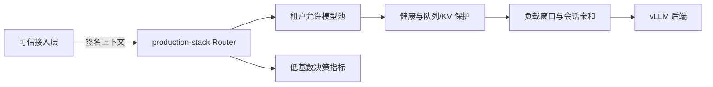

# ServeMesh · 企业多租户推理服务平台

在 [vLLM production-stack](https://github.com/vllm-project/production-stack) 的真实 Router、Helm 部署和可观测体系中，增加面向共享推理集群的租户流量治理。

## 场景与改动

交互问答和离线批处理共享集群时，需要受控的模型池、稳定会话路由与拥塞保护。新增 `tenant-affinity` 路由策略，直接接入上游路由工厂和请求路径。

| 上游基础 | 本次新增 |
|---|---|
| vLLM 推理、LMCache、Kubernetes/Helm、指标采集 | 短期 HMAC 签名租户/会话上下文 |
| 动态端点发现、健康检查、队列/KV 指标 | 租户允许池过滤、未知指标拒绝、队列/KV 使用保护 |
| Router 和 OpenAI 兼容代理 | 负载候选集内的加权前置评分与稳定会话选择 |
| Prometheus/Grafana 部署基础 | 决策计数指标、Secret 引用、策略 ConfigMap 与 Helm schema |

实现位于 `src/vllm_router/tenant_policy.py` 及上游 `routing_logic.py`、请求转发和启动路径。受保护策略会关闭直接端点绕行，并剥离签名上下文头后再转发。外部 provider 和跨租户语义缓存组合在启动时被阻止。

## 部署入口

阅读 [部署与故障演练](enterprise/IMPLEMENTATION.md)，使用 [合成配置](enterprise/values-shared-inference.yaml) 叠加上游 Helm values。
必须构建并指定包含本分支修改的 Router 镜像；上游现成镜像不包含本扩展。签名密钥通过预置 Kubernetes Secret 注入，不能写入 values 或仓库。签名辅助工具仅在可信接入层使用。

本功能是路由策略，不提供 GPU 硬隔离、严格配额、全服务鉴权或网络隔离。签名上下文具有短期 bearer 属性，需由可信入口剥离客户端自带头并重新签发。平台控制 API 应置于独立管理网络；GPU 集群吞吐和成本需另行实测。

[验证记录](enterprise/VALIDATION.md) · [数据边界](enterprise/DATA_POLICY.md) · [固定基线](enterprise/UPSTREAM.json)

## 归属与许可

新增实现使用 AI 辅助；原有推理引擎、缓存、调度与部署能力属于上游贡献者。本次贡献以基线后 diff 为准。保留 Apache-2.0 LICENSE、NOTICE、贡献历史和原始 [README](README.upstream.md)。
